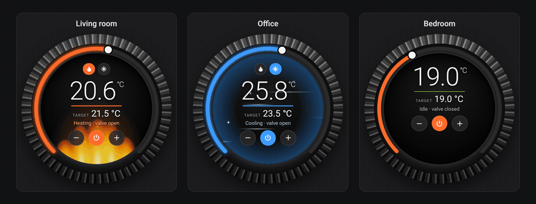
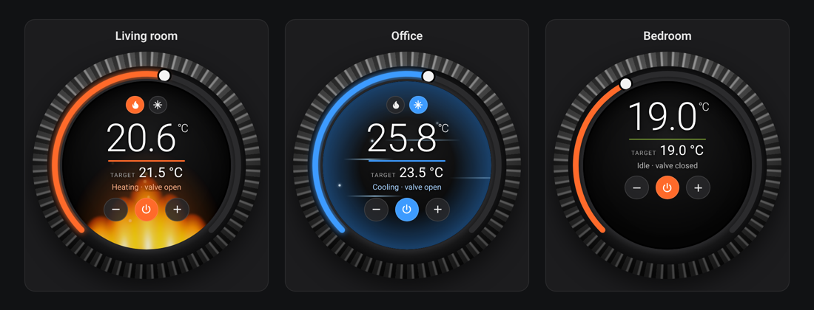

# Heater Cooler Card

[](https://hacs.xyz/docs/faq/custom_repositories)
[](https://github.com/seggershacoder/Heater-Cooler-Home-Assistant/actions/workflows/validate.yml)
[](LICENSE)

**English** · [Deutsch](#deutsch)

A round wall-thermostat card for Home Assistant. A knurled metal bezel, a dark display and a target arc you can drag. While the room heats, a fire burns in the display; while it cools, cold wind and snowflakes blow through it. Power on/off and switching between heating and cooling are built in.

<p align="center">
  
</p>

<p align="center"><sub>Heating · Cooling · Idle</sub></p>

## Features

- **Dial control:** drag the knob around the arc, or use − / +. The value is sent once you let go, not on every step.
- **Fire while heating:** flickering flames, a glowing base and rising embers, driven by the thermostat's `hvac_action`.
- **Cold wind while cooling:** gusts, drifting snowflakes and a blue rim.
- **Power button:** turns the active thermostat on or off.
- **Heat/cool switching**, in three set-ups:
  - **Whole house:** a select helper (for example Winter/Summer) switches every room; your own automation does the rest.
  - **Per room:** separate heating and cooling thermostats; the card turns the other one off before turning the new one on.
  - **Single device:** one thermostat that can both heat and cool, such as an air conditioner.
- **Room name** inside the display or above the dial.
- **English and German**, following your Home Assistant language.
- **Visual editor**, follows the `prefers-reduced-motion` setting, no dependencies.

## Installation

### HACS

1. HACS → ⋮ → **Custom repositories** → add `https://github.com/seggershacoder/Heater-Cooler-Home-Assistant`, category **Dashboard**.
2. Open **Heater Cooler Card**, choose **Download** and reload the browser.

### Manual

1. Copy `dist/heater-cooler-card.js` to `/config/www/`.
2. **Settings → Dashboards → ⋮ → Resources** → add `/local/heater-cooler-card.js` as a **JavaScript module**.

## Configuration

Minimal:

```yaml
type: custom:heater-cooler-card
entity: climate.living_room
```

Whole house, switched with a select helper:

```yaml
type: custom:heater-cooler-card
entity: climate.living_room_heating
cool_entity: climate.living_room_cooling
mode_entity: input_select.climate_mode
heat_option: Winter
cool_option: Summer
name: Living room
name_position: top
```

Per room, with separate heating and cooling thermostats:

```yaml
type: custom:heater-cooler-card
entity: climate.office_heating
cool_entity: climate.office_cooling
```

A single air conditioner that heats and cools:

```yaml
type: custom:heater-cooler-card
entity: climate.bedroom_ac
```

### Options

| Option | Default | Description |
|---|---|---|
| `entity` | required | Heating thermostat, or the only thermostat. |
| `cool_entity` | – | Cooling thermostat for the same room. |
| `mode_entity` | – | `input_select` or `select` that switches the whole house between heating and cooling. Needs `cool_entity`. |
| `heat_option` / `cool_option` | `Winter` / `Summer` (also `Sommer`, `Heat`, `Cool`), else the first and second option | Option values of `mode_entity`. |
| `name` | entity name | Room name. |
| `name_position` | `inside` | `inside` the display or `top` above the dial. |
| `step` | `0.5` | Step for − / + and the arc. |
| `size` | `340` | Maximum dial size in px. The dial shrinks to fit its column. |
| `show_valve` | `false` | Adds “valve open / valve closed” to the status, handy for underfloor heating. |
| `confirm` | `true` | Ask before switching between heating and cooling. Switching a single device never asks. |
| `demo` | – | `heat` or `cool` shows that animation permanently, for previews. The buttons still control the real thermostat. |

### Theming

The colours come from CSS variables you can override with card-mod or a theme: `--hcc-heat`, `--hcc-cool`, `--hcc-idle`.

### Which thermostat is shown

- With `mode_entity`, the card follows the helper: in the cooling option it shows and controls `cool_entity`, otherwise `entity`.
- With `cool_entity` but no helper, it shows the cooling thermostat while that one is on and the heating thermostat is off.
- With a single thermostat that has both `heat` and `cool` modes, the flame and snowflake buttons switch its HVAC mode.

## Deutsch

Ein runder Wandregler für Home Assistant: gerändelter Metallring, dunkles Display und ein Bogen für die Soll-Temperatur, den du mit dem Finger ziehst. Beim Heizen brennt im Display ein Feuer, beim Kühlen ziehen kalte Windböen mit Schneeflocken durch. An/Aus und die Umschaltung zwischen Heizen und Kühlen sind eingebaut.

<p align="center">
  
</p>

**Installation:** HACS → ⋮ → **Benutzerdefinierte Repositories** → `https://github.com/seggershacoder/Heater-Cooler-Home-Assistant` mit der Kategorie **Dashboard** hinzufügen, **Heater Cooler Card** herunterladen und den Browser neu laden.

**Beispiel mit hausweiter Umschaltung (Winter/Sommer) und Fußbodenheizung:**

```yaml
type: custom:heater-cooler-card
entity: climate.wohnzimmer_heizung
cool_entity: climate.wohnzimmer_kuehlung
mode_entity: input_select.klimamodus
heat_option: Winter
cool_option: Sommer
name: Wohnzimmer
name_position: top
show_valve: true
```

Alle Optionen stehen in der Tabelle oben. Die Texte erscheinen auf Deutsch, wenn Home Assistant auf Deutsch eingestellt ist.

## License

[MIT](LICENSE)
